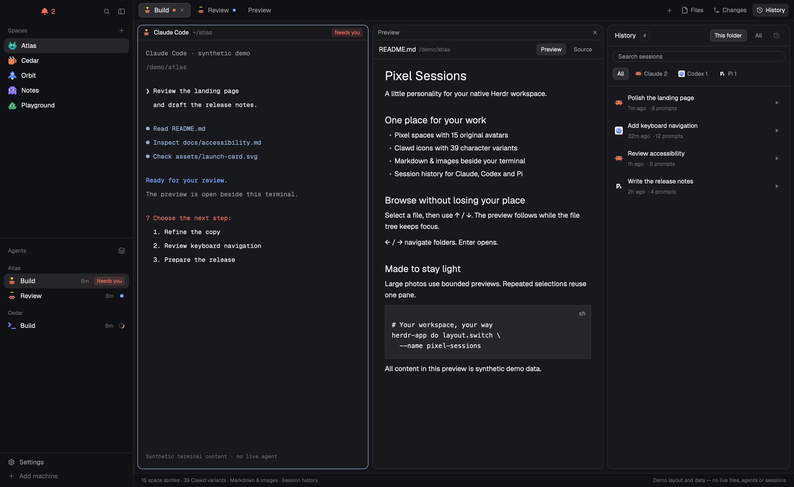
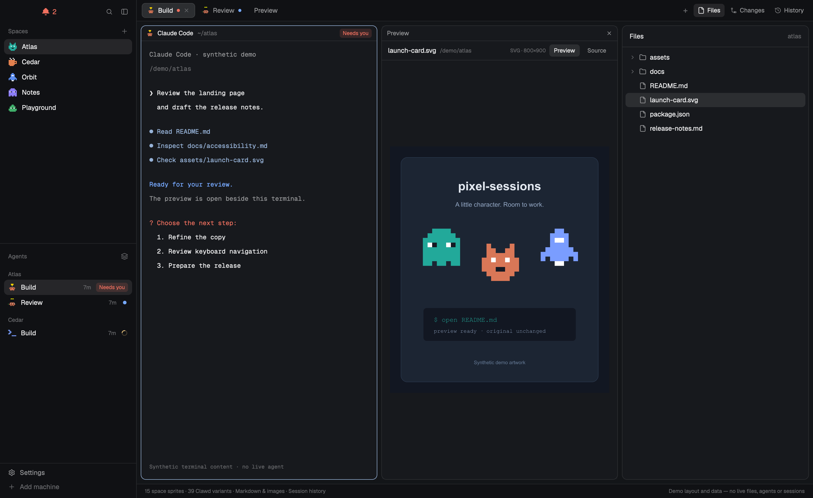

# Pixel Sessions

[English](README.md) · [简体中文](README.zh-CN.md)

One [Herdr desktop](https://herdr.dev/) layout for pixel space avatars, recognisable Claude agents, local and remote session history, and independent Files panes that open any directory by path, and a reusable file preview beside your terminal.



Native Herdr demos use the published layout geometry and synthetic spaces, agents, files and session history. Terminal content is a static demo, not a live agent.

## What it adds

- **Pixel spaces:** 15 coloured sprites, a matching space picker, and a bell for agents that need attention. Option-click a space sprite to change it.
- **Clawd icons:** 39 mascot variants for Claude agents in the sidebar, tabs, and pane headers. The terminal address determines the variant, so it stays consistent across those views.
- **Files + Preview:** click a file to open a pane to the terminal's right. Further selections reuse that tab's preview. Saving a file refreshes its preview.
- Press **⌘⌥O**, or right-click a terminal and choose **New Files**. Enter a directory to browse it in a new right-hand pane.
- **Keyboard browsing:** click Files, then use ↑/↓ to move through visible rows while Preview follows the selected file. The selection stays highlighted and scrolls into view. ←/→ navigates folders; Enter opens a file or toggles a folder; Esc returns to the terminal.
- **History:** browse and search Claude Code, Codex, Antigravity CLI, and Pi sessions on this Mac or a connected machine, inspect transcripts, and resume in a new tab on the machine that owns the session. Transcript dots show each user turn: hover for its prompt and click to jump there.

The status bar remains Herdr's stock status bar. This package does not include quota queries, credential readers, or Quote/0 integration.

## Requirements and limits

- Herdr desktop **0.1.16** is the tested version. Run the mod checks when using a newer release. This is not a Herdr TUI layout.
- `python3` on the owning machine for History, file previews, rename and delete; `git` for repository state.
- Image preparation currently targets **macOS** and uses its built-in `sips`. Rich image previews require local files. On connected machines, Python 3 enables the same bounded text and hex previews. Herdr can still preview small UTF-8 files if remote Python is unavailable.
- The matching `claude`, `codex`, `agy`, or `pi` executable must be installed to Resume that agent.

JPG, PNG, SVG, GIF, BMP, TIFF, HEIC, HEIF, AVIF, ICNS, JP2, PSD, and WebP have been checked with sample files. GIF previews are still images. Additional ImageIO/RAW formats are best effort.

Image previews keep original files unchanged. Large previews are reduced to a longest edge of **2048 pixels**. Disk previews use a **256 MiB / 128-file** least-recently-used budget. Each preview runs at most one preparation job and keeps only the newest pending request. Source files are limited to 64 MiB and 80 million pixels. These are preview limits, not a guarantee about the whole app's memory usage; active images and Herdr's shared image cache also use memory.

## Install

The recommended installation is to give your coding agent this instruction:

> Read `~/.config/herdr-app/AGENTS.md`, then add the layout from https://github.com/jmcarry/pixel-sessions. Keep existing layouts and settings. Rename any conflicting layout or mod names rather than overwriting them.

For a manual installation:

1. Clone this repository. Inspect `RECIPE.md` and the files before installing trusted mod code.
2. Copy `layouts/pixel-sessions.json`, each folder under `mods/`, and `pixel-icons/` into the matching locations under `~/.config/herdr-app/`. **Stop if any destination already exists:** reuse only an identical dependency, or rename the incoming dependency and all of its references. Do not replace a shipped or personal mod.
3. Merge the layout-specific section from `keys.json` into your own key file. It maps ⌘P to the pixel picker, ⌘⌥O to a new Files pane and ⌘⌥W to closing the focused pane only in this layout; global bindings stay unchanged. Merge the two icon fields from `programs.json` if you want the supplied pixel program icons, preserving any existing program settings.
4. Check all eleven copied mods with `herdr-app check ~/.config/herdr-app/mods/<name>`, then switch layouts:

   ```sh
   herdr-app do layout.switch '{"name":"pixel-sessions"}'
   ```

Keep your other layouts. ⌘⇧L cycles through them. If you renamed this layout, update its key section to `layout:<your-name>` too.

## New Files panes

Press **⌘⌥O** or right-click a terminal and select **New Files**. Enter an absolute path, a path relative to the terminal's directory, or `~`, then press **Enter** or **Open**. After opening a directory, relative paths start from that directory. The path stays pinned in its own split while you work elsewhere. It uses the same tree, previews, and file actions as the Files sidebar. On remote spaces the path is resolved on that machine using Python 3. **Shift+right-click** opens the menu when an app inside the terminal handles right-clicks.

## File actions and remote History

Right-click a file or click its **⋯** in **Files** to copy its full path, rename it, or delete it. On this Mac, **Reveal in Finder** selects the file and **Delete** moves it to Trash after confirmation. Remote delete permanently removes the selected file after confirmation. Rename refuses to replace an existing entry. Folders offer Copy Path and local Finder reveal.

In **History**, **Current space** follows the host of the active space. Choose **Local** or a machine name to show its sessions across all folders. **This folder** uses the active folder on that host, and **All** shows its sessions across folders. Use an existing Herdr connection with Python 3 available on the remote host. The helper reads transcripts as the connected OS user, using `CODEX_HOME` and `CLAUDE_CONFIG_DIR` when set. Claude profiles under `~/.claude-profiles/*/projects` and separate Codex homes under `~/.codex-*/sessions` are discovered automatically. Antigravity CLI entries use its read-only local summary index. **Resume** starts the native CLI on the same machine in the recorded working directory. It sets `CLAUDE_CONFIG_DIR` or `CODEX_HOME` for a named profile. On this Mac, an optional `history-launchers.json` in the Herdr app directory can map a Claude profile path or all local AGY sessions to existing zsh aliases. For example, `{"claude": {"/absolute/profile/path": "myclaude"}, "agy": "myagy"}`. The shell loads the alias; pass gateway credentials through the existing wrapper rather than the JSON file.

## Using Preview

Open **Files**, then click any file. Files stays visible; the preview opens as a normal split pane in the current tab. Click Files again before using its keyboard controls.

To close just Preview, click it and press **⌘⌥W** (Herdr 0.1.16 consumes ⌘⇧W before pane bindings), or hover its pane header and click **×**. **⌘W closes the entire tab.** Markdown renders with a Source option, and supported images display inline. Text and source code open in a read-only editor. Other binary formats, such as PDF and archives, display the file size and a hex/ASCII sample. Preview reads at most 256 KiB of text and displays at most 512 bytes of binary data. Relative file links open in Preview. External links open only when clicked.

Closing a preview cancels its file watch and discards its script references and pending selection. Herdr controls decoded image and GPU cache retirement; process memory need not fall immediately after closing a pane.



## Data and processes

Mods are trusted local code. Files reads the selected project, runs directory-listing and read-only Git commands, and watches local files. Pixel spaces queries `git` and `hc`, including machines you already connected to Herdr. History runs Python on the selected host, reads that account’s agent transcripts, and caches the index in `~/.cache/herdr-history-tools/` there. File previews read bounded file prefixes with Python. Image preparation also runs `sips` and writes only its preview cache under Herdr's app folder. Resume starts the selected agent's CLI only when clicked.

There are no autonomous HTTP requests or credential reads in this package. It ships no personal sessions, machine addresses, app state, or preview cache.

## Validation

All eleven mods pass the initial native `herdr-app check` on 0.1.16. Image preparation was exercised with local macOS sample files; Markdown split previews, save refresh, HEIC and SVG rendering were also checked in the app with demonstration files. Keyboard/focus routing, lifecycle cleanup, parser edge cases, and Resume arguments are covered by synthetic tests. The generic preview passed native rendering and save-refresh checks with local test files. Real-agent Resume and remote file preview have not been tested end to end. Run `node --test tests/*.test.mjs` to check file operations, History routing, preview loading, and performance with generated fixtures. See [the test baseline](tests/BASELINE.md).

## Credits and licensing

This is a combined and modified layout, not a claim that every component was created here. It builds on [Herdr](https://github.com/herdrdev/herdr-app), [Pixel Spaces](https://github.com/pilmokim/herdr-pixel-spaces), [Clawd Icons](https://github.com/Agmat/herdr-clawd-icons), and the Markdown/History features of [Herdr Main + Usage](https://github.com/plutotw/herdr-main-usage).

See [LICENSE.md](LICENSE.md) and [THIRD_PARTY_NOTICES.md](THIRD_PARTY_NOTICES.md) for per-component notices and the upstream components that do not declare a license. Claude Code and Clawd are Anthropic's names/character; Codex is OpenAI's. This project is not affiliated with those companies or Herdr.
