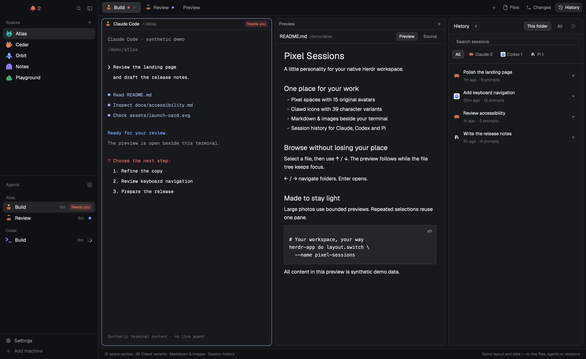
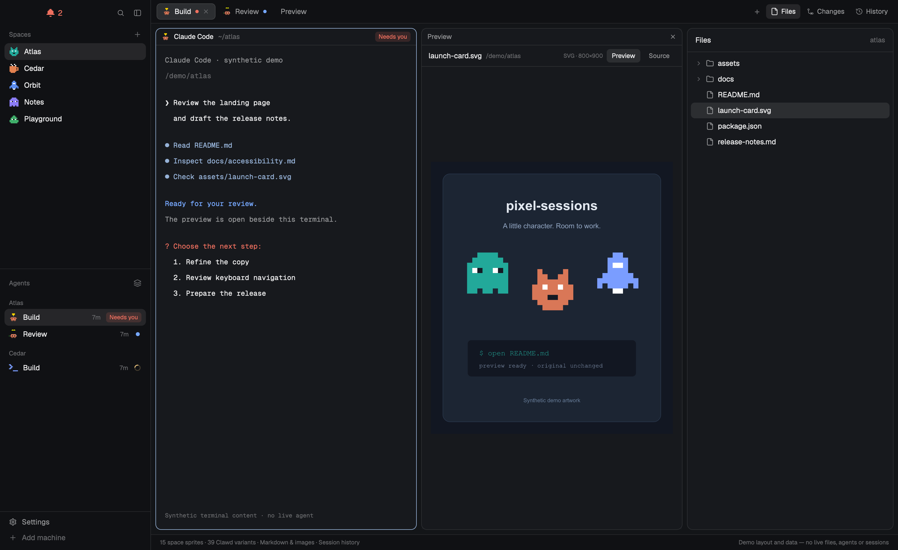

# Pixel Sessions

[English](README.md) · [简体中文](README.zh-CN.md)

一个 [Herdr 桌面版](https://herdr.dev/) 布局：像素空间头像、可区分的 Claude 吉祥物、本机与远程会话历史，以及终端右侧可复用的 Markdown／图片预览窗格。



预览图使用发布布局的实际结构，空间、代理、文件和会话历史均为演示数据；终端内容为静态演示，并非真实代理。

## 功能

- **像素空间：**15 种彩色像素精灵，空间选择器使用相同头像；有代理需要处理时，标题栏显示铃铛。Option 点击空间头像可切换精灵。
- **Clawd 图标：**39 个 Claude 吉祥物变体，用于代理侧栏、标签和窗格标题。按终端地址稳定分配，同一个代理在这些位置显示一致。
- **Files 与 Preview：**点击任意文件，在当前终端右侧打开分屏；继续选文件会复用该标签页的预览窗格，保存后自动刷新。
- **按路径打开 Files：**按 **⌘⌥O**，或右键终端选 **New Files**，再输入目录路径。
- **键盘浏览：**先点击 Files，用 ↑／↓ 选择可见行，预览跟随选中的文件；选中项有高亮并自动滚动到视野内。←／→ 导航文件夹，Enter 打开文件或展开／折叠文件夹，Esc 返回终端。
- **History：**搜索和浏览本机及已连接主机上的 Claude Code、Codex、Antigravity CLI、Pi 会话，查看转录，并在会话所属主机的新标签中 Resume。转录右侧每轮用户提问对应一个点，悬停查看提问，点击跳到该轮。

状态栏保留 Herdr 原版。本项目不包含额度查询、凭证读取或 Quote/0 功能。

## 要求与限制

- 已针对 Herdr 桌面版 **0.1.16** 检查；使用更新版本时请先运行 mod 检查。不适用于 Herdr TUI。
- History、文件预览、重命名和删除需要在文件所属主机上安装 `python3`；仓库状态需要 `git`。
- 图片预览目前面向 **macOS**，使用系统自带的 `sips`；图像渲染需要本机文件。远端有 Python 3 时也可以预览文本和十六进制内容。没有远端 Python 时，可通过 Herdr 读取较小的 UTF-8 文件。
- Resume 对应代理前，需要安装 `claude`、`codex`、`agy` 或 `pi` 命令。

已用样例检查 JPG、PNG、SVG、GIF、BMP、TIFF、HEIC、HEIF、AVIF、ICNS、JP2、PSD、WebP。GIF 显示静态帧，其他 ImageIO／RAW 格式按系统支持尽力处理。

预览不修改原图。大图预览最长边降到 **2048 像素**；磁盘缓存采用 **256 MiB／128 个文件**的最近使用预算。每个预览最多运行一个图片准备任务，只保留最新的待处理请求。原文件限制为 64 MiB、8000 万像素。这些是预览限制，不代表整个 Herdr 进程的内存上限；活跃图片和 Herdr 自身的共享图片缓存也会占用内存。

## 安装

建议直接给编码代理这段指令：

> 读取 `~/.config/herdr-app/AGENTS.md`，然后安装 https://github.com/jmcarry/pixel-sessions 中的布局。保留已有布局与设置；遇到同名布局或 mod 时，重命名新安装的组件及其引用，不要覆盖。

手动安装：

1. 克隆仓库，阅读 `RECIPE.md` 和待安装的文件；mod 是可信本地代码。
2. 把 `layouts/pixel-sessions.json`、`mods/` 下各文件夹、`pixel-icons/` 复制到 `~/.config/herdr-app/` 的对应位置。**目的位置已有同名文件时先停止：**只有完全相同的依赖可以复用，否则应重命名新组件和全部引用。不要覆盖 Herdr 自带或个人 mod。
3. 将 `keys.json` 的布局专属段合并到个人按键配置；它只在此布局中用 ⌘P 打开像素选择器、用 ⌘⌥O 打开独立 Files、用 ⌘⌥W 关闭当前窗格，不改全局按键。需要像素程序图标时，合并 `programs.json` 中两个图标字段，并保留已有程序设置。
4. 对复制后的十一个 mod 分别执行 `herdr-app check ~/.config/herdr-app/mods/<名称>`，然后切换：

   ```sh
   herdr-app do layout.switch '{"name":"pixel-sessions"}'
   ```

保留其他布局，⌘⇧L 可循环切换。如果重命名了布局，按键段也要改为 `layout:<新名称>`。

## 按路径打开 Files

按 **⌘⌥O**，或在终端区右键选择 **New Files**。输入绝对路径、相对路径或 `~`，按 **Enter** 或点 **Open**。首次使用相对路径时以来源终端的目录为基准，之后以该 Files 窗格打开的目录为基准。目录固定在独立右侧窗格，支持和原 Files 一样的文件树、预览和文件操作。远程空间的路径在对应主机解析，需要 Python 3。终端内程序接管鼠标时，用 **Shift+右键** 打开 Herdr 菜单。

## 文件操作与远程 History

在 **Files** 中右键文件或点该行的 **⋯**，可以复制完整路径、重命名或删除。本机 macOS 还可用 **Reveal in Finder** 定位文件。删除前会要求确认，本机文件移到废纸篓，远程文件执行永久删除。重命名遇到同名目标会报错。文件夹也可复制路径，本机文件夹还可在 Finder 中定位。

在 **History** 中，**Current space** 自动跟随当前空间的主机，也可以点 **Local** 或主机名，直接看到所选主机的全部目录。**This folder** 筛选当前主机上的工作目录，**All** 查看所选主机上的全部目录。远程主机需要已经连接 Herdr，并有 Python 3。模块以连接用户身份读取会话，也识别该主机环境中的 `CODEX_HOME` 和 `CLAUDE_CONFIG_DIR`。模块也自动发现 `~/.claude-profiles/*/projects` 中的 Claude 会话和 `~/.codex-*/sessions` 中的独立 Codex 会话，并以只读方式查询 Antigravity CLI 摘要索引。**Resume** 在原主机、原目录启动 CLI，并为具名 profile 设置 `CLAUDE_CONFIG_DIR` 或 `CODEX_HOME`。本机可在 Herdr 配置目录用 `history-launchers.json` 把 Claude profile 路径或本机 AGY 映射到现有 zsh 别名，例如 `{"claude": {"/absolute/profile/path": "myclaude"}, "agy": "myagy"}`。别名由 shell 加载，网关凭证继续由原包装脚本管理。

## 使用预览

打开 **Files**，点击任意文件。文件树保留，Preview 以当前标签页中的普通分屏形式打开。要用上下键继续浏览，先点击 Files。

单独关闭 Preview：点击预览窗格后按 **⌘⌥W**（Herdr 0.1.16 会在窗格按键前截走 ⌘⇧W），或悬停窗格标题栏再点 **×**。**⌘W 会关闭整个标签页。** Markdown 可切换 Source，支持的图片可直接显示；文本和代码以只读编辑器展示。PDF、压缩包等二进制文件显示大小和十六进制／ASCII 摘要。文本最多读取 256 KiB，二进制最多展示前 512 字节。相对文件链接在预览中打开，外部链接只在点击时交给浏览器。

关闭预览会撤销文件监听，并清除该副本的脚本引用与待处理选择。解码后的图片和 GPU 缓存由 Herdr 管理，关闭窗格后进程内存不一定立即下降。



## 数据与本地程序

Files 读取选定项目，运行目录列举及只读 Git 命令，并监听本地文件。像素空间通过 `git`、`hc` 查询状态，也包括已经连接到 Herdr 的机器。History 在所选主机运行 Python，读取该账号的代理转录，并在该主机的 `~/.cache/herdr-history-tools/` 缓存索引。文件预览通过 Python 限量读取内容。图片处理还会调用 `sips`，只在 Herdr 目录中的预览缓存写入文件。只有点击 Resume 时才启动对应代理命令。

本项目没有自主 HTTP 请求或凭证读取，也不打包个人会话、机器地址、应用状态或预览缓存。

## 验证范围

十一个 mod 均通过 0.1.16 的初始原生 `herdr-app check`。图片处理使用本机 macOS 样例文件检查；Markdown 分屏、保存刷新、HEIC 和 SVG 也在应用中用演示文件验证。键盘／焦点路由、生命周期清理、解析边界情况和 Resume 参数使用模拟测试覆盖。全文件预览也用本机样例验证了原生渲染和保存刷新。真实代理 Resume 和远程文件预览尚未做端到端验证。运行 `node --test tests/*.test.mjs` 可用生成的样例检查文件操作、History 主机路由、预览加载和性能，见[测试基线](tests/BASELINE.md)。

## 来源与许可

这是组合并修改后的布局，并非声称全部组件均由本项目原创。来源包括 [Herdr](https://github.com/herdrdev/herdr-app)、[Pixel Spaces](https://github.com/pilmokim/herdr-pixel-spaces)、[Clawd Icons](https://github.com/Agmat/herdr-clawd-icons)，以及 [Herdr Main + Usage](https://github.com/plutotw/herdr-main-usage) 的 Markdown／History 功能。

各组件声明与未明确许可的上游组件见 [LICENSE.md](LICENSE.md) 和 [THIRD_PARTY_NOTICES.md](THIRD_PARTY_NOTICES.md)。Claude Code／Clawd 为 Anthropic 的名称／角色，Codex 为 OpenAI 的名称；本项目与上述公司及 Herdr 均无隶属关系。
