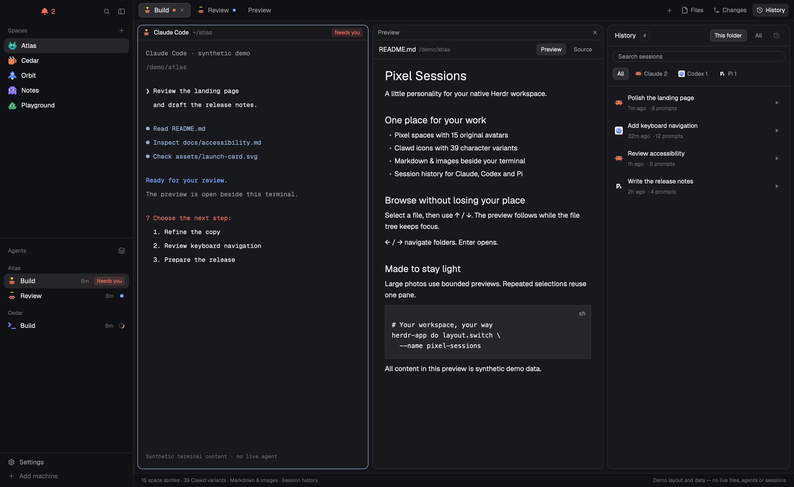

# Pixel Sessions

A native Herdr desktop workspace with colourful pixel space avatars, distinct Claude mascots, Files / Changes / History tabs, and a reusable preview pane beside the terminal. Browse files with the keyboard, inspect a past conversation, then resume it in a new local tab. The layout inherits the person's theme rather than imposing one.

## What you see

- A **268 px sidebar**, `chrome` background, minimum 44 px and maximum 480 px. Its **46 px header** reserves room for macOS traffic lights, shows an attention bell/count only when agents wait, and has search and sidebar controls. Spaces and agents share the middle height with minimum 90 px each. The footer is 69 px.
- Space rows use **15 kinds of 8×8 sprite**, drawn in the space's stable colour, at 16×16 inside an 18 px area. Worktree rows retain branch markers. Machines stay grouped and spaces preserve Herdr's repository, branch, order and recovery behaviour.
- Claude agents use one of **39 Clawd pictures**, consistently in the agent list, tab and pane header. Other programs use their normal icon; `programs.json` optionally supplies the two pixel program glyphs.
- A **42 px tab bar** above the work area. Agent tabs keep native status marks and live titles. On the right are **Files**, **Changes**, **History** buttons; clicking the active panel button hides the panel.
- A work area with 8 px padding and gaps. Terminal panes have a 30 px top header, radius 10, one-pixel border, and accent focus border. A preview is an ordinary right-hand split in this same tab, not a separate layout block or web view.
- A **368 px right panel**, adjustable from 280 to 900 px, containing a `panel-body` stack of Files / Changes / History. Files has a 42 px header and a lazy file tree. History has search, scope and agent filters, session rows, then the selected transcript.
- A **28 px stock status bar**. No quota display, tokens, personal hardware bridge or e-ink integration is included.

## How it behaves

**Agents and spaces.** `blocked` and unread `done` agents appear in the header's bell count. Blocked takes priority; clicking the bell focuses the most urgent agent. Working uses a native spinner and idle is quiet. The same terminal keeps its mascot across status changes. A new space receives a least-used sprite and keeps it by space id. Option-click changes that sprite without changing the selected space. Plain click, right-click menus, drag order, worktree grouping and machine controls retain Herdr's behaviour. The search button and this layout's ⌘P open the pixel picker; arrows and Enter select a tab and Esc closes it.

**Files and preview.** Selecting any file creates a preview to the right of an explicit terminal pane. The file tree remains visible. Further selections in that tab update the existing managed preview, including fast successive selections while the host is applying the first split. A separately opened manual preview remains independent. Preview shows the filename/folder and, for images, the original dimensions; images fit with their aspect ratio preserved. Markdown and SVG have Preview / Source controls. Text and code use a read-only editor. Other binary formats show the file size and a hex/ASCII sample. Relative file links stay in Preview. External links open only on click.

Click Files to give it keyboard focus. ↑/↓ selects visible rows, highlights them, and scrolls them into view. Previews follow the selected file after a short 90 ms selection delay, discarding intermediate requests during rapid navigation. The file tree stays visible while reading text or binary files. → expands a folder or selects its first child, ← collapses it or selects its parent, Enter toggles a folder, and Esc returns to the terminal. Modified arrow shortcuts keep their existing meaning. Preview updates leave focus in Files so the next arrow still works there.

Local preview panes watch their selected file's folder; saving refreshes the content. Remote file preview uses a gentle three-second fallback poll. Watch requests are cancelled when replaced or closed. Close only Preview with its pane-header × or by focusing it and pressing ⌘⌥W (the host consumes ⌘⇧W before the pane keymap); ⌘W closes the tab.

**Images.** Native JPG / PNG / SVG are used where suitable. macOS `sips` prepares other supported formats and downsamples large images to a longest edge of 2048 px, keeping source files unchanged. Cache paths include source identity and version information, so a save cannot reuse a stale decoded image. Disk cache uses a 256 MiB / 128-file least-recently-used budget. One preparation job runs per preview, with only the latest pending selection retained. Closing discards pending work and script references; Herdr controls native decoded-image and GPU cache retirement.

**History.** Read local Claude Code, Codex and Pi transcript stores and display the 100 most recent matching conversations. Search filters client-side. “This folder” uses the focused local repository root or folder; “All” shows local history across folders. Clicking a row reads its last 400 transcript entries, with tool output abbreviated. Resume starts `claude --resume <id>`, `codex resume <id>`, or `pi --session <file>` in a new local tab in the recorded folder. A remote focused space does not redirect a local transcript's resume to that machine.

With two or more user turns, the transcript has a right-edge dot rail. Hover a dot for its turn number and prompt. Clicking restarts the lazy transcript list at that turn; “Show N earlier entries” returns to the complete retained transcript. This implements a jump without depending on an unavailable lazy-list scrolling API.

## Built from

`layouts/pixel-sessions.json` is a personal clone of Herdr `main` 0.1.16. The root has a sidebar column and work column. Work contains the tabs block, a row of the active tab and right panel, then the stock status bar. Keep the `panel-body` stack and its distinct `files`, `changes`, `history` child ids.

| Folder | Role |
| --- | --- |
| `pixel-spaces` | Current Herdr spaces plus sprites and Option-click cycling; queries Git and core machine state |
| `pixel-picker` | Current picker plus the same sprite drawings; opened by the header or layout-specific key |
| `pixel-chrome` | Sidebar header with waiting bell, search and collapse controls |
| `agents-clawd` | Current agent list and subagents with address-based Claude mascots |
| `pane-clawd` | Current pane header with matching mascots and a human-readable Preview title |
| `clawd-icons` | 39 SVG mascot assets and an empty `place: none` mod |
| `tabs-tools` | Current tabs plus the History panel button, mascot icons and remembered panels |
| `files-md-tools` | Lazy Files tree, selected-row state, keyboard focus, per-tab preview routing |
| `md-preview-tools` | Markdown, images, read-only text and hex; `file_preview.py` reads bounded file prefixes; `images.py` prepares bounded image previews |
| `history-tools` | History UI and `history.py` local transcript index / reader |

The layout also uses shipped `workspace-chrome` for its footer, `workspace-status`, `changes`, and Herdr's shared menus/icons. Those are supplied by Herdr and are not overwritten. `keys.json` only adds `layout:pixel-sessions` / `cmd-p` and `cmd-alt-w`; `programs.json` contains only two optional icon overrides.

Preview props are `{ file, on?, tab?, selectionKey? }`. The managed file selection is shared by tab, while a standalone preview can use `{ file, on }`. Source and image generation are bounded and asynchronous. Herdr APIs include `spaces`, `panes`, `focused`, `agents`, `machines`, `shared` / `setShared`, `run`, `nextCommand`, `exec`, `hc`, `readTextFile`, `watchFolder`, `theme`, `settings`, `props`, and `checking`. GPUI provides focus handles, `ScrollHandle`, native controls, Markdown, images and editors.

Processes: `git` and directory-listing commands for files/repositories, `hc` for known machines, `python3` for History and file previews, macOS `sips` for image metadata/conversion, and the agent CLIs only on Resume. External links use the system opener only when clicked. No background HTTP or credential reading is part of this layout.

## Watch out

- Read the target Herdr home's `AGENTS.md` and check against its generated type declarations. Shipped mods are replaced on app start; these custom folders and layout must remain separate. If a name exists, rename the incoming copy and every self-reference rather than overwriting it. This includes helper script paths, shared selection/registry keys and private cache paths when renaming the preview or history mods.
- Keep the two `sprites.js` copies identical; mods cannot import from another mod's folder. Keep the Clawd hash and `% 39` count consistent in the agent list, pane header and tabs.
- Space colour/sprite assignment changes nothing when no spaces are present. `checking()` guards helper processes during checks. A passing initial check alone does not test later async states or lazy transcript rows.
- Files keyboard events belong to its focus handle. Updating Preview must not leave keyboard focus there. Preserve selection through list refreshes and expand/collapse changes; keep the tree visible while every file type opens in Preview.
- Explicitly target a source terminal when splitting. Do not use a composition terminal or guess ownership of an old manual preview. A pending first split must not create duplicate previews.
- Image support currently requires local macOS files, `python3` and `/usr/bin/sips`. Remote files use bounded text or hex previews when Python 3 is available. Small UTF-8 files can use Herdr’s native reader when it is unavailable. GIF previews are static; RAW formats are best effort. Source images are capped at 64 MiB and 80 million pixels; preview output must also fit Herdr's native asset limit. These do not constitute a hard process-RAM limit.
- Herdr 0.1.16 has a shared idle native image cache budget of 128 MiB / 128 entries, separate from this module's disk cache ([host implementation](https://github.com/herdrdev/herdr-app/blob/v0.1.16/vendor/gpui-pre/src/app.rs#L2910)). Active pictures are outside that idle budget, and RSS need not drop immediately after closing a pane. Do not claim immediate GPU/RAM release.
- History indexes personal files at runtime; never distribute an index or transcript with this package. Claude / Codex / Pi command availability is separate from transcript discovery. An absent agent executable can prevent Resume.
- The layout reads local project files and connected-machine status. Publish only code/assets and a preview with synthetic names and content. Do not include `shared.json`, `view.json`, `data/`, caches, settings, credentials or generated type declarations.
- Preserve the component-specific license notices in `THIRD_PARTY_NOTICES.md`; some upstream original additions do not declare a license.

## Done when

1. All ten `herdr-app check` calls pass against the target Herdr version; `herdr-app status` has no mod/config errors.
2. The sidebar shows sprites, Option-click cycles one, and ⌘P opens the matching picker without replacing the global key.
3. A Claude terminal has the same mascot in sidebar, tab and pane header; a shell keeps its normal icon.
4. Clicking any file opens a right-hand split, later selections reuse it, and Files stays visible. Saving refreshes it.
5. Repeated ↑/↓ in Files changes the selected file and preview without focus leaving Files or extra panes appearing. Folder navigation works and the tree remains visible for ordinary files.
6. A large local image produces a bounded preview without changing the source; HEIC / TIFF and native PNG / SVG samples render. Failed conversions show a bounded text or hex fallback and explain why the image is unavailable. Closing cancels watches and pending selections.
7. History lists local conversations, transcript dots show prompts and jump to their turns, and Resume targets a new local tab with the correct agent arguments and folder.
8. `preview.png` shows synthetic content, the default README is English with a Chinese link, and the public repository has topic `herdr-layout` for the official Gallery's Community indexing.
